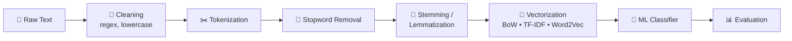

<div align="center">

# 🧠 Natural Language Processing — Learning & Projects

**Hands-on Jupyter notebooks covering text preprocessing, text representation, and machine-learning-based text classification.**

<br>


[Overview](#-overview) •
[Tech Stack](#-tools-and-technologies) •
[Techniques](#-nlp-techniques-covered) •
[Projects](#-projects-included) •
[Notebooks](#-foundational--concept-notebooks) •
[Setup](#-installation) •
[Best Practices](#-notes-and-good-practices)

</div>

---

## 📌 Overview

This repository is a **learning portfolio** of NLP experiments, from the basics (tokenization, stemming, lemmatization) to complete text-classification pipelines.

It includes two end-to-end applications:

| # | Project | Feature Representations |
|:-:|---|---|
| 1 | 📩 **SMS Spam / Ham Classification** | Bag of Words • TF-IDF • Word2Vec |
| 2 | 📚 **Amazon Kindle Review Classification** | Bag of Words • TF-IDF • Word2Vec |

> [!NOTE]
> Results can vary with the train/test split, preprocessing choices, and model settings. Run the notebooks to reproduce the metrics in your own environment.

### 🗺️ Project overview


### 🔄 General pipeline



---

## 🛠️ Tools and Technologies

| | Tool / Library | How it is used |
|:-:|---|---|
|  | **Python** | Main programming language |
|  | **Jupyter Notebook** | Interactive development and experimentation |
|  | **pandas** | Loading and manipulating text datasets |
|  | **NumPy** | Numerical arrays and vector operations |
|  | **NLTK** | Tokenization, stopwords, stemming, lemmatization, POS tagging, and basic NER workflow |
|  | **scikit-learn** | Vectorization, train/test split, ML models, and evaluation metrics |
|  | **Gensim** | Training and loading Word2Vec embeddings |
|  | **Matplotlib** | Plotting and visualizing model comparisons |
|  | **Seaborn** | Statistical plots and comparison charts |
|  | **Regular Expressions (`re`)** | Removing unwanted characters and cleaning text |
|  | **BeautifulSoup** | HTML tag removal in review-text preprocessing |
|  | **tqdm** | Progress bars for processing loops |

---

## 📚 NLP Techniques Covered

### 1️⃣ Text Preprocessing

| Technique | Purpose |
|---|---|
| **Tokenization** | Splits text into sentences or individual words/tokens. |
| **Lowercasing** | Converts text to a consistent lowercase form. |
| **Text cleaning** | Removes unwanted characters, such as punctuation or non-letter characters, using regular expressions. |
| **Stopword removal** | Removes common words (for example, "the", "is", "and") when they are not useful for the task. |
| **Stemming** | Reduces words to stems by stripping prefixes/suffixes; the result is not always a valid dictionary word. |
| **Lemmatization** | Converts words to linguistically valid base forms, optionally using part-of-speech information. |

<details>
<summary><b>🔍 Stemming & lemmatization details</b></summary>

<br>

**Stemming algorithms demonstrated**
- `PorterStemmer`
- `RegexpStemmer`
- `SnowballStemmer` (Porter2-style English stemming)

**Lemmatization**
- NLTK `WordNetLemmatizer`
- Examples using noun, verb, and adverb POS options

</details>

### 2️⃣ Text Representation / Feature Extraction

Machine-learning algorithms need numerical features rather than raw text. These notebooks explore:

| Technique | How it represents text | Main idea |
|---|---|---|
| **Bag of Words (BoW)** | Word-count or binary occurrence vectors | Represents a document by the words it contains, without understanding word order. |
| **N-grams** | Counts/sequences of adjacent tokens | Uses unigrams, bigrams, and higher-order token groups to capture short phrases. |
| **TF-IDF** | Weighted term vectors | Gives more weight to terms that are frequent in a document but less common across documents. |
| **Word2Vec** | Dense word embeddings | Learns vector representations in which words used in similar contexts can have similar vectors. |
| **Average Word2Vec** | One vector per document | Averages the Word2Vec vectors of the words in a document to create a fixed-length document vector. |

<details>
<summary><b>⚙️ Implementation details found in the notebooks</b></summary>

<br>

- `CountVectorizer` with `max_features`, binary features, and `ngram_range`
- `TfidfVectorizer` with feature limits and n-gram settings
- Gensim `Word2Vec`, including a CBOW training configuration and pretrained Google News Word2Vec vectors
- Average Word2Vec document vectors, with zero vectors used when no token is in the embedding vocabulary

</details>

### 3️⃣ Linguistic NLP Tasks

| Task | Description |
|---|---|
| 🏷️ **Part-of-Speech (POS) tagging** | Assigns grammatical labels such as noun, verb, adjective, and adverb to tokens. |
| 📍 **Named Entity Recognition (NER)** | Identifies named entities such as people, locations, organizations, dates, times, money, and percentages. |
| ✂️ **Sentence & word tokenization** | Splits paragraphs into sentences and sentences into words. |

### 4️⃣ Machine-Learning Algorithms

| Classifier | Where it is used |
|---|---|
| **Multinomial Naive Bayes** | SMS spam classification with sparse count/TF-IDF features |
| **Gaussian Naive Bayes** | Kindle review experiments with BoW, TF-IDF, and averaged Word2Vec features |
| **Logistic Regression** | Kindle model-comparison workflow |
| **Random Forest Classifier** | Word2Vec-based spam classification experiment |

---

## 🚀 Projects Included

### 📩 Project 1 — SMS Spam / Ham Classification

**🎯 Goal:** classify an SMS message as `spam` or `ham` (not spam).

**🗃️ Dataset:** `SMSSpamCollection` text file, loaded as tab-separated data with `label` and `message` columns.

<details open>
<summary><b>📋 Workflow</b></summary>

<br>

1. Load the SMS dataset with pandas.
2. Clean message text using regular expressions.
3. Convert text to lowercase and tokenize it.
4. Remove English stopwords.
5. Apply stemming or lemmatization, depending on the notebook.
6. Split the data into training and testing sets.
7. Convert text into numerical features using:
   - Bag of Words (including binary features and n-grams)
   - TF-IDF
   - Word2Vec / Average Word2Vec
8. Train classification models, including Multinomial Naive Bayes and Random Forest.
9. Evaluate predictions using accuracy and classification metrics.

</details>

**📓 Related notebooks**
- `2Spam Ham Classification Project Using TF-IDF And ML.ipynb`
- `Spam Ham Classification Project Using BOW And TFIDF And ML.ipynb`
- `Spam_Ham_Using_Word2vec_AvgWord2vec.ipynb`

---

### 📚 Project 2 — Amazon Kindle Review Sentiment Analysis

**🎯 Goal:** use review text and rating labels to explore sentiment/review classification with different text representations.

**🗃️ Dataset:** a subset of the Amazon Kindle Store 5-core reviews dataset. The notebook describes a source dataset with 982,619 entries and fields including product ID (`asin`), helpfulness, rating (`overall`), review text, and review time. The notebook loads `all_kindle_review.csv`.

<details open>
<summary><b>📋 Workflow</b></summary>

<br>

1. Load the review dataset.
2. Clean review text, including HTML/text cleanup.
3. Remove stopwords and apply WordNet lemmatization.
4. Split the data into training and testing sets.
5. Create separate feature sets using BoW, TF-IDF, and Word2Vec.
6. Train and compare classifiers, including Gaussian Naive Bayes, Logistic Regression, and Random Forest.
7. Evaluate using accuracy, precision, recall, F1-score, confusion matrix, and classification report.
8. Visualize comparisons between models and feature representations.

</details>

> [!IMPORTANT]
> The notebook uses the `rating` target column. This is rating-based review classification; it should only be described as binary positive/negative sentiment if the labels are explicitly mapped into those two classes in the executed workflow.

**📓 Related notebook**
- `Project_2_Kindle_Review_Sentiment_Analyis.ipynb`

---

## 📓 Foundational / Concept Notebooks

| Notebook | Main topics |
|---|---|
| ✂️ `Tokenization Example NLTK.ipynb` | Sentence tokenization, word tokenization, `wordpunct_tokenize`, `TreebankWordTokenizer` |
| 🚫 `Stopwords.ipynb` | NLTK stopwords, filtering, stemming, Snowball stemming, lemmatization |
| 🌱 `Stemming.ipynb` | Porter, Regexp, and Snowball stemmers |
| 📖 `Lemmatization.ipynb` | WordNet lemmatizer and POS-aware examples |
| 🎒 `Bag Of Words.ipynb` | Count vectors, binary BoW, bigrams and n-grams |
| ⚖️ `TF-IDF.ipynb` | TF-IDF vectors and bigram features |
| 🧬 `Word2vec.ipynb` | Pretrained Word2Vec vectors and word similarity |
| 🏷️ `Parts Of Speech Tagging.ipynb` | Sentence tokenization and POS tagging concepts |
| 📍 `Named Entity Recognition.ipynb` | Tokenization and NER with example entities |

---

## 📊 Evaluation Metrics

| Metric | What it tells you |
|---|---|
| **Accuracy** | Proportion of all predictions that are correct. |
| **Precision** | Among items predicted as a class, how many actually belong to that class. |
| **Recall** | Among actual items in a class, how many the model correctly finds. |
| **F1-score** | Harmonic mean of precision and recall. |
| **Confusion matrix** | Shows correct and incorrect predictions for each class. |
| **Classification report** | Provides precision, recall, F1-score, and support for each class. |

> [!TIP]
> For spam detection, precision and recall are especially useful alongside accuracy because false spam flags and missed spam messages have different consequences.

---

## 📁 Repository Structure

```text
NLP/
│
├── 📓 Foundations
│   ├── Tokenization Example NLTK.ipynb
│   ├── Stopwords.ipynb
│   ├── Stemming.ipynb
│   ├── Lemmatization.ipynb
│   ├── Bag Of Words.ipynb
│   ├── TF-IDF.ipynb
│   ├── Word2vec.ipynb
│   ├── Parts Of Speech Tagging.ipynb
│   └── Named Entity Recognition.ipynb
│
├── 📩 Project 1 — Spam / Ham
│   ├── 2Spam Ham Classification Project Using TF-IDF And ML.ipynb
│   ├── Spam Ham Classification Project Using BOW And TFIDF And ML.ipynb
│   └── Spam_Ham_Using_Word2vec_AvgWord2vec.ipynb
│
└── 📚 Project 2 — Kindle Reviews
    └── Project_2_Kindle_Review_Sentiment_Analyis.ipynb
```

> [!NOTE]
> Keep datasets in the expected paths used by the notebooks (for example, `SpamClassifier/SMSSpamCollection.txt` and `all_kindle_review.csv`). Dataset files are not included in this repository.

---

## ⚙️ Installation

It is recommended to create a fresh virtual environment rather than upload a local `venv` folder to GitHub.

```bash
# Create a virtual environment
python -m venv .venv

# Activate on Windows
.venv\Scripts\activate

# Activate on macOS / Linux
source .venv/bin/activate

# Install libraries
pip install numpy pandas nltk scikit-learn gensim matplotlib seaborn beautifulsoup4 tqdm jupyter
```

Some NLTK notebooks require downloaded corpora/tokenizers. Run the relevant downloads in a notebook when prompted:

```python
import nltk

nltk.download("stopwords")
nltk.download("punkt")
nltk.download("punkt_tab")
nltk.download("wordnet")
nltk.download("omw-1.4")
```

## ▶️ Running the Notebooks

1. Clone or download this repository.
2. Create and activate a Python virtual environment.
3. Install the dependencies.
4. Place the required datasets in the paths referenced by the notebooks.
5. Start Jupyter:

   ```bash
   jupyter notebook
   ```

6. Open a notebook and run its cells from top to bottom.

---

## ✅ Notes and Good Practices

- 🔒 **Avoid data leakage:** fit vectorizers on the training data only, then use `.transform()` on the test data.
- 🎲 **Reproducibility:** use a fixed `random_state` in `train_test_split`.
- ⚖️ **Imbalanced data:** don't rely on accuracy alone; inspect precision, recall, F1-score, and the confusion matrix.
- 🧬 **Word2Vec:** train on training text only when evaluating a held-out test set.
- 💾 **Memory:** large dense arrays from `.toarray()` can use a lot of memory. Prefer sparse matrices when the model supports them.
- 🧪 **Fair comparison:** use the same train/test split and evaluation metrics across feature extraction methods.
- 🔢 **Ratings are ordinal:** choose and document the target-label strategy before interpreting the task as sentiment classification.

---

## 🎓 Learning Outcomes

- ✅ Cleaning and preparing raw text for NLP
- ✅ Tokenizing sentences and words
- ✅ Removing stopwords and applying stemming/lemmatization
- ✅ Converting text into numerical features using BoW, N-grams, and TF-IDF
- ✅ Learning word embeddings with Word2Vec and building document vectors with Average Word2Vec
- ✅ Applying linguistic NLP tasks such as POS tagging and NER
- ✅ Training machine-learning classifiers for text classification
- ✅ Evaluating and comparing models with standard classification metrics

## 🔮 Future Improvements

- [ ] Add reproducible experiment settings and fixed random seeds to every project
- [ ] Compare more classifiers and tune hyperparameters with cross-validation
- [ ] Add explicit label mapping and class-balance analysis for review sentiment
- [ ] Save model/vectorizer artifacts and build a small prediction interface
- [ ] Add notebook outputs or a results table containing verified metrics
- [ ] Add a clean `requirements.txt` and dataset download instructions

---

<div align="center">

**👤 Author: Samsur Rahman**

`Natural Language Processing` • `Text Preprocessing` • `Text Vectorization` • `Machine Learning`

⭐ If you found this repository helpful, consider giving it a star!

</div>